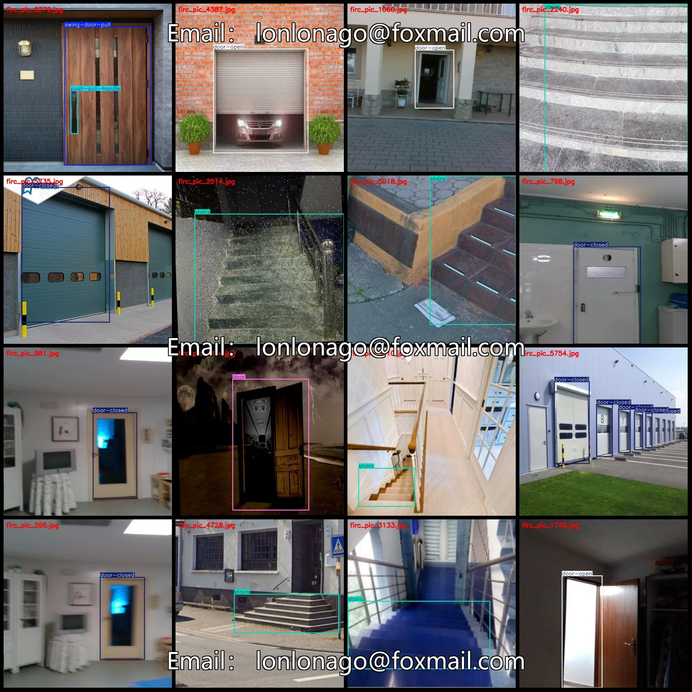
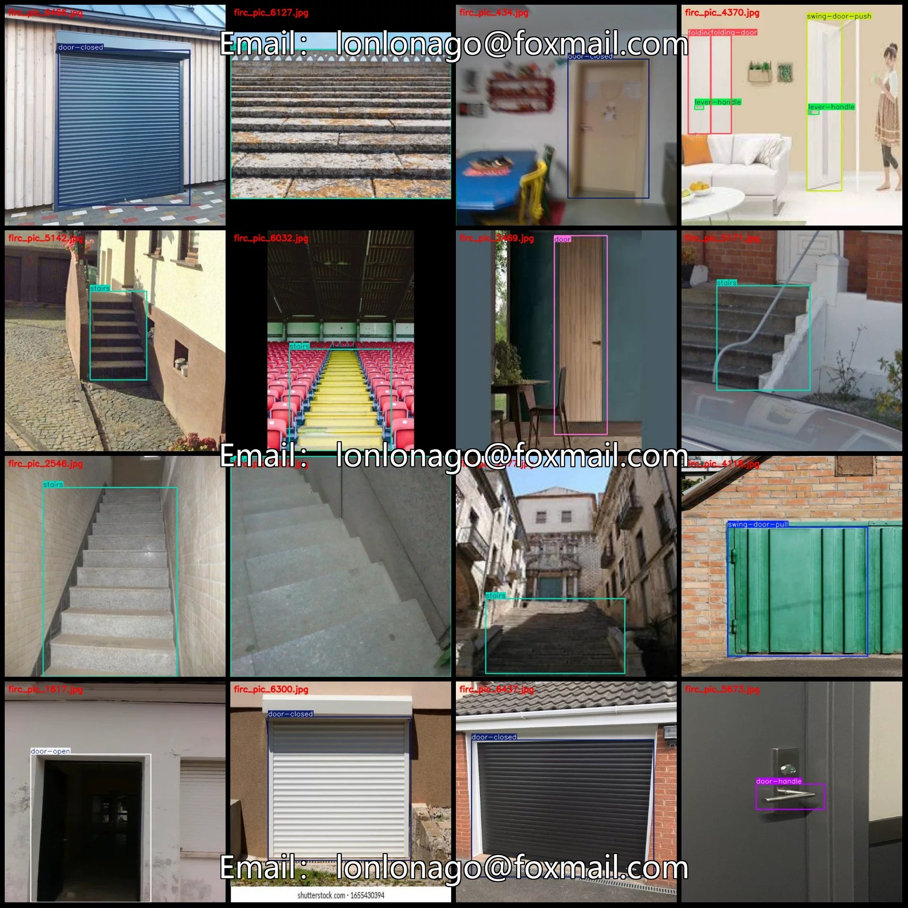
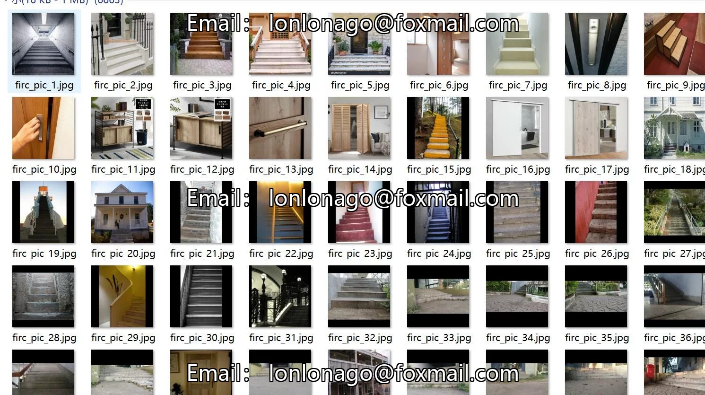
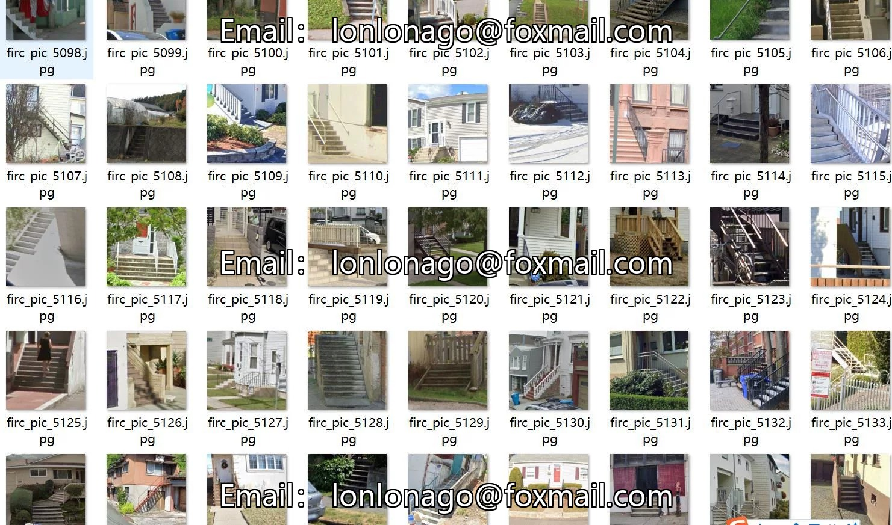

# Dataset of Doorknob and Door Status Detection in VOC+YOLO format with 6748 images in 14 classes

## Body

Handrail and Door Status Detection Dataset VOC+YOLO format: 6748 images in 14 categories
Tips: Due to the dataset's replicability, please confirm compliance before purchasing.
Dataset format: Pascal VOC format + YOLO format (txt file without split path, only containing jpg images and corresponding VOC format xml files and yolo format txt files)
Number of images (number of jpg files): 6748
Number of annotations (number of xml files): 6748
Number of annotations (number of txt files): 6748
Number of annotation categories: 14

Label category names (Note that the order of labels in the YOLO format does not correspond to this, but is based on the classes.txt file in the labels folder): ["door", "door-closed", "door-handle", "door-handle-pull", "door-knob", "door-open", "door-puller", "folding-door", "lever-handle", "push-pull-handle", "slide-door", "stairs", "swing-door-pull", "swing-door-push"]

Number of boxes and images occupied by each category
Door (door) = 236, occupied images = 196
Door-closed (door closed) = 1759, occupied images = 1467
Door-handle (door handle) = 200, occupied images = 199
Door-handle-pull (door pull handle) = 41, occupied images = 41
Door-knob (door knob) = 94, occupied images = 69
Door-open (door open) = 1130, occupied images = 1065

Door-puller (door puller/door latch) Frames = 135, Image Count = 73
Folding-door (folding door) Frames = 288, Image Count = 105
Lever-handle (lever handle) Frames = 255, Image Count = 188
Push-pull-handle (push-pull handle) Frames = 248, Image Count = 158
Slide-door (slide door) Frames = 215, Image Count = 116
Stairs (stairs) Frames = 3864, Image Count = 3245

Swing-door-pull (Pull handle for swing doors) Frames = 433, Image Count = 338
Swing-door-push (Push handle for swing doors) Frames = 82, Image Count = 66
Total Frames: 8980
Image Resolution: 640x640
Labeling Tool: labelImg
Labeling Rules: Draw a rectangle around the category.
Important Note: The dataset does not have separate training, validation, or test sets; you need to partition them yourself.
Special Remark: This dataset does not guarantee the accuracy of the trained models or weight files.

## Images

## Payment

Here is a pay link on Stripe ( https://buy.stripe.com/3cs8yP7sY87d0vu9AB ). Please contact me lonlonago@foxmail.com after funding $89, and I will send you a complete data files , thank you!

